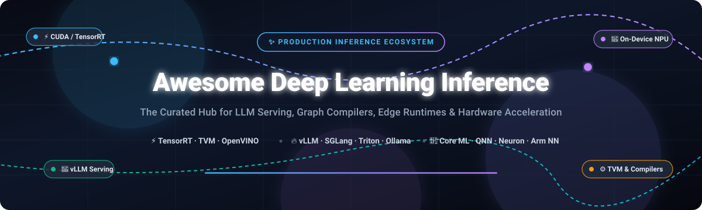

# ⚡ Awesome Deep Learning Inference

<p align="center">
  
</p>

<p align="center">
  <a href="https://github.com/ishandutta2007/Awesome-Awesome-Awesome"></a>
  <a href="https://discord.gg/jc4xtF58Ve"></a>
  <a href="https://github.com/ishandutta2007/Awesome-Deep-Learning-Inference"></a>
  <a href="https://github.com/ishandutta2007/Awesome-Deep-Learning-Inference/network/members"></a>
  <a href="https://github.com/ishandutta2007/Awesome-Deep-Learning-Inference/blob/main/LICENSE"></a>
  <a href="https://github.com/ishandutta2007"></a>
</p>

---

## 🚀 Top Deep Learning Inference Ecosystem

**Curated List of Production SaaS Platforms & Open-Source Projects for Deep Learning Inference**  
*Focused on Large Language Model (LLM) Serving, Graph Compilation, Hardware Acceleration & Edge Inference*  

🕒 **Last updated: October 2026**

This repository provides an authoritative, SEO-indexed directory tracking premier **SaaS inference platforms** and **open-source deep learning inference engines**. Whether deploying massive LLMs into production, compiling PyTorch computation graphs for dedicated silicon, quantizing weights to low-bit representations, or targeting edge devices and mobile NPUs, this guide catalogs the optimal tools across the full model serving stack.

* **Key Focus Areas**: High-Throughput LLM Serving, Deep Learning Graph Compilers, On-Device Neural Processing Units (NPUs), Low-Bit Quantization (FP8, INT4, AWQ, GPTQ), Zero-Copy Memory Paging, and Multi-Hardware Model Optimization.
* **Open-Source & Cloud Synergy**: Comprehensive evaluation of commercial cloud acceleration vs. self-hosted open-source runtimes for ML engineers, AI architects, platform teams, and researchers.

---

## 📑 Table of Contents

- [📊 Sector Overview & Market Dynamics](#-sector-overview--market-dynamics)
- [☁️ SaaS/Hosted Platforms](#️-saashosted-platforms)
- [🛠️ Open-Source GitHub Projects](#️-open-source-github-projects)
- [🤝 How to Contribute](#-how-to-contribute)
- [💖 Support & Sponsor](#-support--sponsor)
- [📈 Star History](#--star-history)
- [⚖️ Disclaimer](#️-disclaimer)

---

## 📊 Sector Overview & Market Dynamics

The global **AI & Deep Learning Inference market** is estimated at approximately **$100B–$130B in 2025** and is projected to expand beyond **$250B by 2030**, exhibiting a compound annual growth rate (CAGR) of over **19%**. This seismic growth is fueled by the industry-wide inflection from capital-intensive model pre-training to continuous, low-latency production inference across enterprise SaaS, generative agentic workflows, autonomous systems, and edge robotics.

Market concentration across the inference sector exhibits a **bifurcated, moderately concentrated structure**:
1. **Cloud & Silicon Acceleration (Concentrated / Oligopoly)**: At the high-performance hardware and managed accelerator tier, the market operates under high concentration with high barriers to entry. Giant semiconductor and hyperscale cloud providers (NVIDIA, Apple, Amazon AWS, and Qualcomm) dominate hardware-bound runtime engines, proprietary micro-architectures, and high-bandwidth interconnects.
2. **Serving Software & Runtime Layer (Dynamic & Fragmented)**: Conversely, the software serving, orchestration, and quantization layer is highly active, vibrant, and driven by open-source innovation (e.g., vLLM, Ollama, llama.cpp, SGLang, and ONNX Runtime). Enterprise teams frequently combine vendor hardware drivers with vendor-agnostic open serving frameworks to avoid hardware lock-in and optimize price-per-token economics.

---

## ☁️ SaaS/Hosted Platforms

The following table summarizes enterprise SaaS and hosted inference acceleration platforms, sorted by corporate valuation / market cap in descending order.

| Platform | Company Valuation / Revenue | Description & Key Strengths | Pricing | Free Tier Limits |
| :--- | :--- | :--- | :--- | :--- |
| **NVIDIA TensorRT (Commercial Support / NVIDIA AI Enterprise)** | **~$4.54 Trillion Market Cap** (FY25 Revenue: ~$130B+) | ⚡ SDK for ultra-high-performance deep learning inference on NVIDIA GPUs. While core components are open source, enterprise commercial support, LTS branches, SLA-backed engineering troubleshooting, and certified security patches require NVIDIA AI Enterprise. Features automated kernel auto-tuning and layer fusion for NVIDIA Hopper/Blackwell architectures. | Starts at **$4,500/GPU/year** (1-year subscription including Business Standard Support) or **$1.00/GPU/hour** on cloud CSP marketplaces (AWS, Azure, GCP). | **90-day free trial** of NVIDIA AI Enterprise software evaluation license on compatible NVIDIA-certified infrastructure. |
| **Apple Core ML (Apple Developer Program)** | **~$4.05 Trillion Market Cap** (FY24 Revenue: ~$391B) | 🍎 Apple's native framework for on-device inference on iPhone, iPad, Mac, and Apple Vision Pro. Closed-source compiler and runtime utilizing `coremltools` for model conversion (`.mlmodel`). Delivers zero-latency execution directly tailored for the Apple Neural Engine (ANE) and unified memory GPU architecture. | **$99/year** for standard Apple Developer Program membership (required for TestFlight beta testing and App Store distribution). | **Free forever** with a standard Apple ID for local development and on-device testing via Xcode (apps side-loaded on personal devices expire every 7 days). |
| **AWS Neuron (Amazon EC2 Inf1 / Inf2 / Trn1)** | **~$2.47 Trillion Market Cap** (FY24 Revenue: ~$620B) | ☁️ Turnkey cloud inference accelerator instances powered by AWS custom silicon (Inferentia 1/2 and Trainium). Closed-source compiler and runtime paired with open-source MLIR-based NKI compiler, engineered specifically for high-throughput, cost-optimized generative AI and transformer inference on AWS EC2. | Starts at **$0.362/hour** for `inf1.2xlarge` and **$0.758/hour** for `inf2.xlarge` (On-Demand pricing in US regions; AWS Neuron SDK software itself is free). | **12-month free trial** credits for new AWS accounts (starts with $100 promotional credits valid across services up to 6 months; note that Inf1/Inf2 instances are excluded from the standard 750 hrs/month micro-instance Free Tier). |
| **Qualcomm QNN (Neural Processing SDK / Qualcomm AI Hub)** | **~$183 Billion Market Cap** (FY24 Revenue: ~$39B) | 📱 Qualcomm's SDK and hosted cloud AI Hub for deep learning inference on Snapdragon mobile, compute, and IoT platforms. Features QNN execution provider for ONNX Runtime on Hexagon NPUs with industry-leading watt-per-token power efficiency for battery-powered devices. | **$0** (Free developer license via Qualcomm Developer Network; commercial distribution governed by standard QDN product license terms). | **Free forever** with a registered Qualcomm ID account (includes access to SDK downloads, pre-optimized model catalog, and cloud device benchmarking/profiling on Qualcomm AI Hub). |

---

## 🛠️ Open-Source GitHub Projects

The premier open-source repositories powering self-hosted deep learning inference, graph compilation, model quantization, and production model serving—**sorted by GitHub Star Count in descending order**.

| Rank | Project & Repository | Stars Badge | License | Primary Focus & Capabilities |
| :---: | :--- | :---: | :---: | :--- |
| 1 | **[Ollama](https://github.com/ollama/ollama)** | [](https://github.com/ollama/ollama/stargazers) | MIT | 🦙 **Turnkey Local LLM Execution**: Get up and running with Llama 3, DeepSeek, Mistral, and custom models locally across macOS, Windows, and Linux with a single command and OpenAI-compatible API. |
| 2 | **[llama.cpp](https://github.com/ggerganov/llama.cpp)** | [](https://github.com/ggerganov/llama.cpp/stargazers) | MIT | 💻 **Pure C/C++ Inference Engine**: The gold standard for quantized CPU/GPU inference with zero dependencies. Powers GGUF quantization formats (2-bit to 8-bit), Apple Metal acceleration, and bare-metal edge serving. |
| 3 | **[vLLM](https://github.com/vllm-project/vllm)** | [](https://github.com/vllm-project/vllm/stargazers) | Apache-2.0 | 🚀 **High-Throughput Production LLM Serving**: Pioneered PagedAttention for zero-waste KV cache management, continuous batching, chunked prefill, speculative decoding, and native tensor-parallel GPU scaling. |
| 4 | **[DeepSpeed](https://github.com/microsoft/DeepSpeed)** | [](https://github.com/microsoft/DeepSpeed/stargazers) | Apache-2.0 | ⚡ **Extreme Scale Optimization**: DeepSpeed-Inference delivers high-performance tensor-parallel serving, ZeRO-Inference offloading to NVMe/CPU memory, and ultra-fast kernel fusion for massive models. |
| 5 | **[SGLang](https://github.com/sgl-project/sglang)** | [](https://github.com/sgl-project/sglang/stargazers) | Apache-2.0 | 🏎️ **Fast Serving & Structured Generation**: RadixAttention for automatic KV cache reuse across complex multi-turn conversations and agentic workflows, delivering market-leading token generation throughput. |
| 6 | **[Google MediaPipe](https://github.com/google/mediapipe)** | [](https://github.com/google/mediapipe/stargazers) | Apache-2.0 | 📷 **On-Device Vision & Multimodal Solutions**: Cross-platform customizable ML pipelines for live and streaming perception (face mesh, pose tracking, hand landmarks, audio classification) across Android, iOS, and Web. |
| 7 | **[ONNX Runtime](https://github.com/microsoft/onnxruntime)** | [](https://github.com/microsoft/onnxruntime/stargazers) | MIT | 🌐 **Cross-Platform Scoring Standard**: The universal execution runtime with multi-hardware Execution Providers (TensorRT, OpenVINO, QNN, DirectML, CoreML). Powers flagship Microsoft services with 2x+ CPU speedups. |
| 8 | **[Apache TVM](https://github.com/apache/tvm)** | [](https://github.com/apache/tvm/stargazers) | Apache-2.0 | 🧩 **End-to-End Deep Learning Compiler**: Transforms computational graphs into minimal hardware-tuned executables across CPUs, GPUs, and custom micro-accelerators using TensorIR and Relax. |
| 9 | **[NVIDIA TensorRT (Open-Source Repo)](https://github.com/NVIDIA/TensorRT)** | [](https://github.com/NVIDIA/TensorRT/stargazers) | Apache-2.0 | 🟢 **NVIDIA Acceleration Parsers & Plugins**: Open-source ONNX parsers, custom plugins, and developer samples powering the core proprietary TensorRT acceleration runtime on NVIDIA GPUs. |
| 10 | **[Triton Inference Server](https://github.com/triton-inference-server/server)** | [](https://github.com/triton-inference-server/server/stargazers) | BSD-3-Clause | 🏢 **Multi-Model Enterprise Serving Layer**: Concurrent model execution, dynamic batching, and unified gRPC/HTTP endpoints for PyTorch, TensorRT, ONNX, vLLM, and custom C++/Python backends. |
| 11 | **[Intel OpenVINO](https://github.com/openvinotoolkit/openvino)** | [](https://github.com/openvinotoolkit/openvino/stargazers) | Apache-2.0 | 🔷 **Intel Hardware Optimization**: Converts and accelerates models from PyTorch/TensorFlow across Intel Xeon CPUs, integrated GPUs, discrete Arc GPUs, and Intel VPUs without CUDA dependencies. |
| 12 | **[Text Generation Inference (TGI)](https://github.com/huggingface/text-generation-inference)** | [](https://github.com/huggingface/text-generation-inference/stargazers) | HFOIL-1.0 | 🤗 **Hugging Face LLM Serving Stack**: Purpose-built Rust/Python engine for low-latency text generation, FlashAttention-2, Paged Attention, continuous batching, and Hugging Face Hub integration. |
| 13 | **[BentoML](https://github.com/bentoml/BentoML)** | [](https://github.com/bentoml/BentoML/stargazers) | Apache-2.0 | 🍱 **Unified AI Application Framework**: Package ML models and pipelines into containerized, autoscaling microservices ready for Kubernetes and multi-cloud deployment. |
| 14 | **[bitsandbytes](https://github.com/bitsandbytes-foundation/bitsandbytes)** | [](https://github.com/bitsandbytes-foundation/bitsandbytes/stargazers) | MIT | 💾 **Accessible Low-Bit Quantization**: Lightweight Python wrapper around custom CUDA kernels enabling 8-bit and 4-bit (QLoRA, NF4, FP4) inference and memory-efficient execution. |
| 15 | **[TensorFlow Lite Micro](https://github.com/tensorflow/tflite-micro)** | [](https://github.com/tensorflow/tflite-micro/stargazers) | Apache-2.0 | 🔬 **Ultra-Low-Power Embedded Inference**: Bare-metal ML runtime designed to fit in under 16 KB on Arm Cortex-M microcontrollers without operating system or dynamic memory allocation. |
| 16 | **[pytorch/TensorRT](https://github.com/pytorch/TensorRT)** | [](https://github.com/pytorch/TensorRT/stargazers) | BSD-3-Clause | 🔥 **Torch-Native NVIDIA Acceleration**: Seamless compiler for PyTorch/TorchScript/FX that automatically converts supported subgraphs to TensorRT engines with PyTorch fallback. |
| 17 | **[Arm NN](https://github.com/ARM-software/armnn)** | [](https://github.com/ARM-software/armnn/stargazers) | MIT | 💪 **Arm Architecture Acceleration**: Bridges neural networks to Arm Cortex-A CPUs and Mali GPUs via the Arm Compute Library (ACL) and Android NNAPI driver. |
| 18 | **[OpenVINO Model Server (OVMS)](https://github.com/openvinotoolkit/model_server)** | [](https://github.com/openvinotoolkit/model_server/stargazers) | Apache-2.0 | ⚡ **Intel Optimized Microservice Serving**: High-throughput C++ gRPC/REST serving layer implementing KServe v2 specification for OpenVINO-optimized pipelines. |

---

## 🏗️ Architecture Blueprint: Building Custom Inference Stacks

Modern production architectures blend compilers, serving layers, and hardware backends:

```text
┌────────────────────────────────────────────────────────────────────────┐
│                   Production Inference Architecture                    │
└────────────────────────────────────────────────────────────────────────┘
                                    │
                                    ▼
       ┌────────────────────────────────────────────────────────┐
       │   Serving & Orchestration Layer (HTTP / gRPC APIs)      │
       │   vLLM · SGLang · Triton Server · Ollama · BentoML     │
       └────────────────────────────┬───────────────────────────┘
                                    │
                  ┌─────────────────┴─────────────────┐
                  ▼                                   ▼
   ┌─────────────────────────────┐     ┌─────────────────────────────┐
   │ Graph Compilers & Runtimes  │     │ Quantization & Memory       │
   │ ONNX Runtime · TVM · TFLite │     │ bitsandbytes · AWQ · FP8    │
   └──────────────┬──────────────┘     └──────────────┬──────────────┘
                  │                                   │
                  └─────────────────┬─────────────────┘
                                    │
                                    ▼
       ┌────────────────────────────────────────────────────────┐
       │   Hardware Execution Engines & Vendor Silicon Drivers  │
       │   NVIDIA TensorRT · Intel OpenVINO · Apple Core ML     │
       │   Qualcomm QNN · AWS Neuron · Arm NN                   │
       └────────────────────────────────────────────────────────┘
```

---

## 🤝 How to Contribute

Contributions are warmly welcomed to keep this directory comprehensive and up to date!

1. 🍴 **Fork the repo** to your personal GitHub account.
2. 🌿 **Create a descriptive branch**: `git checkout -b add/new-inference-tool`.
3. 📝 **Add or update entries** in `README.md` following the existing tabular and badge formats. Include factual descriptions, official documentation links, licensing, and pricing.
4. 🚀 **Submit a Pull Request** with a concise summary of the addition or update.

---

## 💖 Support & Sponsor

If you find this repository valuable for your production engineering, research, or architecture benchmarking:

* ⭐ **Star this repository** to support discoverability across the AI community!
* 🍴 **Fork and share** with colleagues and platform teams.
* ☕ **Buy a coffee & sponsor ongoing maintenance**: Support development on the [GitHub Sponsors Dashboard](https://github.com/sponsors/ishandutta2007).

Your sponsorship helps keep these ecosystem benchmarks, hardware guides, and market analysis continuously refreshed. Thank you! 🙏

---

## 📈 Star History

[](https://star-history.dera.page/#ishandutta2007/Awesome-Deep-Learning-Inference&type=date&legend=top-left)

---

## ⚖️ Disclaimer

* This repository is a **community-curated index** for informational, architectural, and educational purposes. Mention of products or frameworks does not constitute a formal commercial endorsement.
* Hardware performance, latency numbers, and token throughput vary significantly across model architectures, precision modes (FP32, FP16, BF16, FP8, INT4), batch sizes, and hardware configurations. Benchmark thoroughly in your target deployment environment.
* Deep learning inference frameworks frequently update licenses, API boundaries, and hardware execution providers. Verify licensing conditions with respective project owners before commercial rollout.

---

<p align="center">
  <b>Built with ❤️ for ML engineers, AI platform teams, and systems researchers worldwide.</b><br/>
  <i>Let's make Deep Learning Inference faster, cost-efficient, and accessible across all hardware.</i>
</p>
